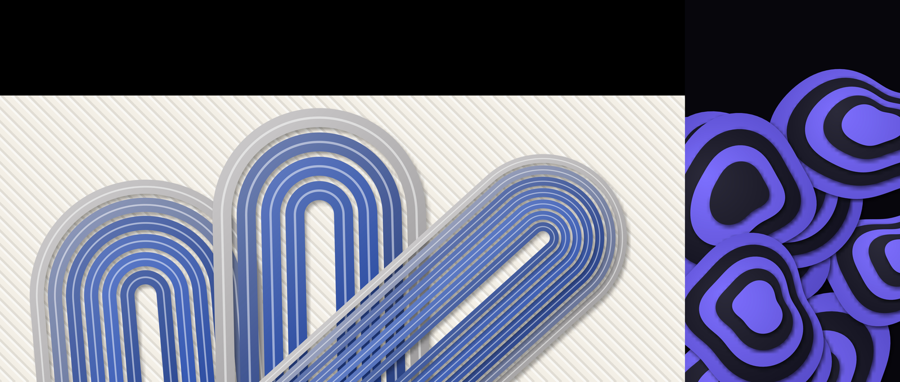
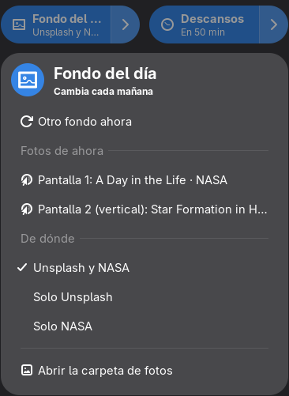

# Fondo del día

Extensión de GNOME que cambia el fondo cada 30 minutos con fotos al azar de **Unsplash** y de la
**NASA**. Con varios monitores pone una foto distinta en cada uno, del tamaño y la forma de esa
pantalla: una ancha para el ultrawide, una vertical para el monitor vertical.



*Un ultrawide (3440×1440) y un monitor vertical (1080×1920) a su derecha. Lo negro es la zona
donde no hay pantalla: nunca se ve.*

## Qué hace
- **Una foto por pantalla.** GNOME solo deja poner una imagen para todas las pantallas, así que la
  extensión arma una sola imagen grande donde cada foto cae justo sobre su monitor (opción
  «spanned» de GNOME). Funciona con monitores de distintos tamaños, verticales y ultrawide.
- **Cambia sola cada 30 minutos** (también al volver de suspender, si ya pasó ese rato). También
  cambia la pantalla de bloqueo.
- **Al conectar o quitar un monitor** vuelve a acomodar el fondo: reusa las fotos actuales que
  tengan la forma de cada pantalla y solo baja foto para las que no tengan.
- **Unsplash:** fotos al azar ya recortadas al tamaño de tu pantalla, vía [Picsum](https://picsum.photos).
- **NASA:** de su [biblioteca de imágenes](https://images.nasa.gov): nebulosas, galaxias, planetas y
  la Tierra desde la estación espacial. Solo imágenes científicas (descarta fotos de prensa y de
  laboratorio), sin collages de varios paneles, y que recortadas a la forma de tu pantalla sigan
  siendo grandes.
- Sin cuentas ni claves.

## Dónde se controla


En los **Ajustes rápidos** (el menú de arriba a la derecha, el del wifi y la batería) aparece
**Fondo del día**:
- El botón prende o apaga el cambio automático.
- La flechita abre el menú: **Otro fondo ahora**, quién tomó cada foto (clic para verla en la web),
  de dónde salen (**Unsplash y NASA**, **Solo Unsplash** o **Solo NASA**; al elegir una, el fondo
  cambia en ese momento) y la carpeta de fotos.

Las fotos se guardan en `~/.local/share/fondos/` (las últimas 24 fotos y 6 fondos armados; las más
viejas se borran solas).
<br clear="right">

## Instalar
```bash
git clone https://github.com/DimitriMedNov/fondos.git
cd fondos
./install.sh
```
Cierra sesión y vuelve a entrar. Funciona en GNOME 48 a 51. Necesita `gjs` (viene con GNOME).

`./install.sh --quitar` la quita; tu fondo actual se queda como está.

## Cómo funciona
| Archivo | Qué hace |
|---|---|
| `extension.js` | El botón de Ajustes rápidos, el cambio cada 30 min y el cambio al conectar monitores |
| `componer.js` | Programa aparte (`gjs -m`): baja una foto por pantalla, la recorta y arma la imagen final. Corre fuera de GNOME para que el escritorio no se congele con imágenes grandes |
| `fuentes.js` | Picsum (Unsplash) y la biblioteca de la NASA, con los filtros de tamaño y color |

Probar el armado sin GNOME (un ultrawide y un vertical a su derecha):
```bash
cd extension
gjs -m componer.js '{"carpeta": "/tmp/fondos", "pantallas": [{"x": 0, "y": 480, "ancho": 3440, "alto": 1440}, {"x": 3440, "y": 0, "ancho": 1080, "alto": 1920}]}'
```

## Licencia
MIT. Las fotos son de sus autores: Unsplash ([licencia de Unsplash](https://unsplash.com/license)) y
NASA (dominio público, salvo que la imagen diga otra cosa).
